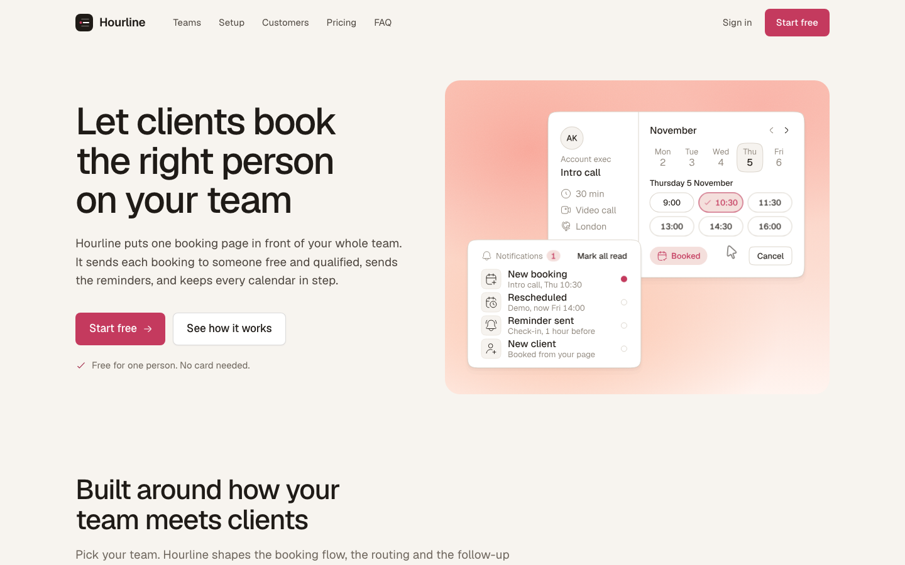

# Hourline

A free landing page template for a made-up product called Hourline, scheduling and booking for teams who meet clients all day. It is illustrated with nine animated assets by [Illos](https://illos.dev), in the Interface style, lettered in the page's own font (Geist) with the page's own 12 px corners.

[](https://vercel.com/new/clone?repository-url=https%3A%2F%2Fgithub.com%2Fnavedux%2Fillos-hourline-template)

Live demo: https://illos-hourline-template.vercel.app



The page has a hero where a client books a time and the team's notifications follow, team tabs (Sales, Recruiting, Support, Consulting) that swap the copy, two results and an animated asset, a setup board with three steps as tabs, a customer story on a photo, a keyboard section, pricing with a monthly and yearly switch, and questions that open and close.

Hourline is not a real company. Change the name, the copy, the people and the numbers to your own.

## Run it

You need Node 18 or later.

```
npm install
npm run dev
```

Then open the address Vite prints, usually http://localhost:5173.

## Build it

```
npm run build
```

The finished site goes to `dist/`. It is plain HTML, CSS and JavaScript, so any static host can serve it. `npm run preview` serves `dist/` locally so you can check the build.

## Edit it

- `index.html` holds the page and all its copy. Icons are Hugeicons, inlined as SVG.
- `src/style.css` holds the styles. Colours, radii and shadows are CSS variables at the top, with the scales the page uses written out above them.
- `src/main.js` plays the animated assets while they are on screen, and runs the mobile menu, the tabs (click or arrow keys), the billing switch and the copy button.
- `illos/` holds the animated assets as SVG files. `public/img` holds the photos, `public/fonts` the Geist font.

Each asset sits in the page as a comment such as `<!-- illos:calendar-booking -->`. The build swaps the comment for the SVG inline, so the asset can read the page's colours. To move one, move its comment. To use another, drop the SVG into `illos/` and add a comment with its file name. Never put the same file on a page twice.

The assets take their colours from the `--illos-*` variables in `src/style.css`. Change `--accent` and the booked slot, the toggles and the unread dots in every asset follow.

## How the motion behaves

- Each asset loops while it is on screen and pauses when it scrolls away.
- The two hero cards run on one shared cycle in one container: the client books on the left card, and the notification on the right card follows.
- With reduced motion turned on in the system settings, every asset shows one still frame and the page skips its transitions.
- There are no scroll effects: the animated assets are the motion.

## Fonts and photos

Geist is self-hosted in `public/fonts` (SIL Open Font License). The three photos were generated for this template and contain no real people, brands or text.

## Licence

The code is MIT. The animated assets and photos are free to use in sites you build from this template, but not to redistribute on their own. See `LICENSE.md`.

## More animated assets

The assets come from [Illos](https://illos.dev), where there are more in the same style, along with the skills that let your coding agent make new ones in your own font and corners.
